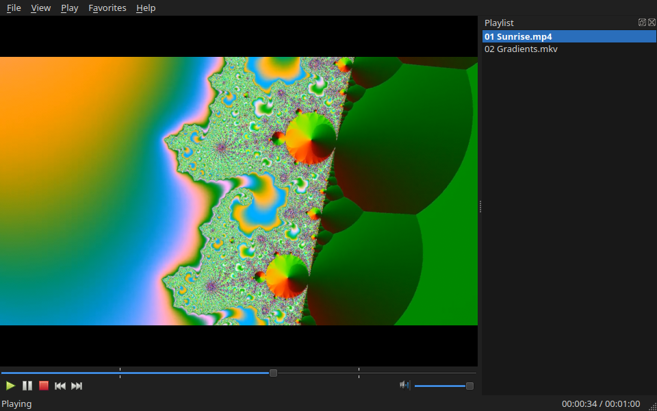
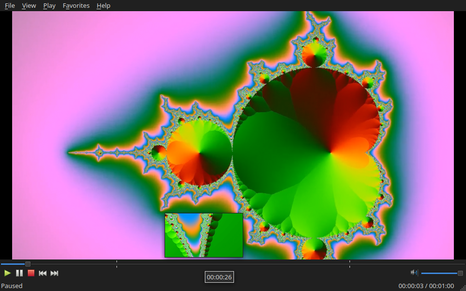
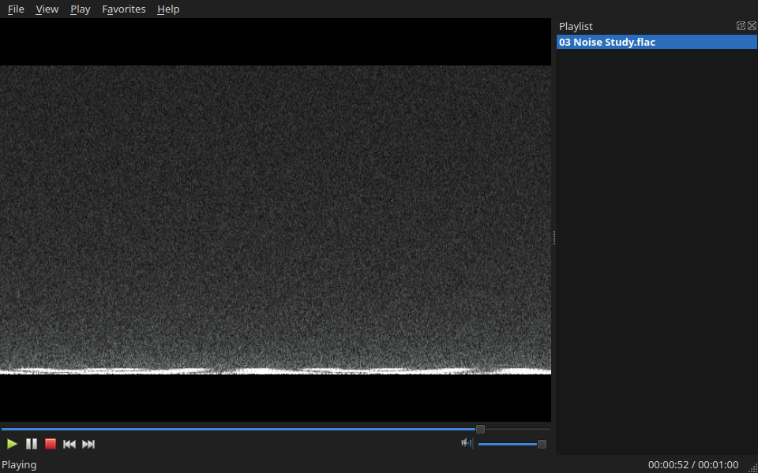
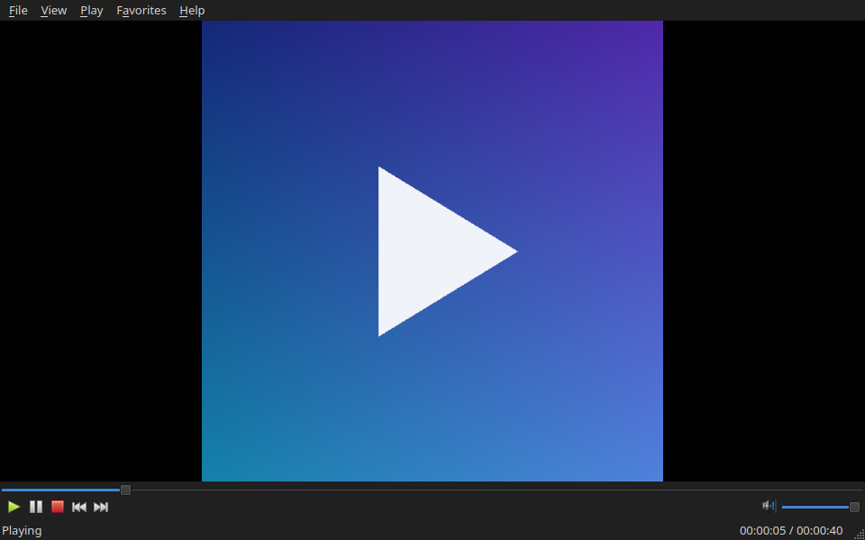
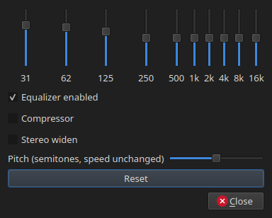

# Reelplay

A classic-style media player for Linux, built on Qt 6 and libmpv. It keeps the look and the
keyboard-driven feel of MPC-BE (Media Player Classic - Black Edition), but it is not affiliated
with that project. Reelplay was formerly called newmpc-be.



Reelplay plays what VLC plays, runs from a single window by default, and remembers where you
left off in every file.

## Features

### Playback

- **Everything libmpv and FFmpeg can decode**, plus DVD and Blu-ray folders, `VIDEO_TS.IFO`
  and `.iso` images, Audio CDs, and network streams (http, rtsp, rtmp, srt, udp, mms, HLS).
  See [Formats](#formats).
- **Seek bar:** click to jump straight to a point. Hover to see the time and a frame preview
  from that point. Previews are cut with ffmpeg, so they need local files.
- **Chapters:** Play > Chapters, Ctrl+PgDn / Ctrl+PgUp, and S to skip an intro, recap, opening,
  or credits chapter (matched by its title). Options > Player can skip them automatically.
- **Repeat and A-B:** repeat the file or the playlist, and set A and B markers to loop a section.
- **Resume:** each file starts where you left it. Favorites and per-file bookmarks let you
  jump back to a place later.
- **Record stream (experimental):** Play > Record Stream copies the stream to a file. mpv marks
  this feature experimental: the file is written when recording stops, and a recording started
  partway through can begin with frames that won't decode.



### Picture

- **View > Video:** brightness, contrast, saturation, gamma and hue; rotate; flip horizontally;
  deinterlace; crop to 4:3, 16:9, 1.85:1 or 2.35:1 (centred).
- **Scaling:** default, sharp (EWA Lanczos) or smooth (Spline36) upscaling.
- **Smooth motion and shaders:** View > Video > Smooth Motion interpolates frames to the display
  rate, which costs GPU time. Upscaling Shader loads a GLSL file of your own that mpv runs on each
  frame, and Clear Upscaling Shader removes it.
- **Filters:** HDR tone mapping, denoise and sharpen.
- **Window:** always on top, fullscreen (Alt+Enter, or double-click; Esc leaves), zoom at 50%,
  100% or 200%, and the menu bar, controls and status bar can each be hidden.
- **Screenshots:** F5 saves one automatically, Alt+I asks where to save it, and File > Screenshot
  Series saves one every N seconds.
- **Statistics:** Ctrl+J shows codec, size, dropped frames and sync.

Denoise, sharpen, rotation, flip, deinterlace and the crop choice are remembered between sessions.
A crop applies to every file.

### Audio

- **Output:** choose the device under Play > Audio Output > Device, and normalize the volume.
- **Equaliser:** Play > Audio Output > Equalizer > Open Equalizer. It has 10 bands from 31 Hz to
  16 kHz (-12 to +12 dB), a compressor, stereo widen, and presets (Flat, Bass Boost, Treble Boost,
  Voice). Bands above 45% of a file's sample rate are skipped, because ffmpeg rejects them.
- **Pitch:** the same dialog has a pitch slider in semitones. It changes the pitch and keeps the
  speed.
- **S/PDIF passthrough:** sends AC3, E-AC3, DTS and TrueHD to a receiver undecoded. It is off by
  default. On a stereo device it gives silence or garbled sound, so only turn it on with a receiver
  connected to the selected output.
- **Visualiser:** View > Visualizer (audio files) draws a spectrum where the picture would be, for
  files with no video track.
- **Cover art:** an embedded cover image is shown. A `cover.jpg` or `folder.jpg` beside the file
  also works.
- **Save section:** Play > A-B Repeat > Save Section cuts the A-B section to a new file with ffmpeg.
  The cut starts at the keyframe before A, so the section can begin a little early.
- **After playback:** Play > After Playback can do nothing, exit, shut down, or suspend when the
  playlist ends.

<table>
<tr>
<td></td>
<td></td>
</tr>
<tr>
<td></td>
<td></td>
</tr>
</table>

### Files and playlists

- **Open:** files, folders (natural sort, so ep2 comes before ep10), recent files, a URL, or an
  Audio CD.
- **Playlist (Ctrl+7):** drag to reorder. Right-click to remove, randomize, save as M3U, or clear.
- **Playlist files:** `.m3u`, `.m3u8`, `.pls`, `.xspf`, `.asx`/`.wax`/`.wvx`, `.wpl`, `.ram` and
  `.cue` open as playlists.
- **Single window:** opening a file while Reelplay is running (for example, double-clicking in the
  file manager) plays it in the existing window. Turn this off in Options. Options also has "play
  the next file in its folder when one ends", which is off by default.
- **Walking a folder:** when you open a single file, Next and Previous step through its folder,
  like MPC-BE.

### Subtitles

Subtitles named like the video (for example `film.en.srt` for `film.mkv`) load automatically,
including from a `Subs/` or `Subtitles/` subfolder. Font, size, colour and position are in
Options > Subtitles.

### Desktop integration

- **Multimedia keys:** Play, Pause, Stop, Next and Previous work even when Reelplay isn't focused.
  On Cinnamon, GNOME and MATE the player claims the keys from the desktop, so the last player you
  used gets them.
- **MPRIS:** Reelplay shows up in the sound applet and works with `playerctl`. Volume keys stay
  with the system volume, as in VLC.
- **Open With:** the package adds a menu entry, an icon, and "Open With" entries for video and
  audio files.

## Formats

Reelplay plays what VLC plays, through libmpv and FFmpeg. It covers all of VLC 3.0's video and
audio file extensions (Open Folder picks them up), the same file types for "Open With", and the
playlist formats listed above.

Not supported: MIDI and SID music. VLC needs extra plugins for those too.

Sites such as YouTube go through yt-dlp, which must be recent. Mint's packaged version (2024.04)
no longer works with YouTube.

## Install

### Debian and Ubuntu package

Download the `.deb` from the [releases page](https://github.com/FireFoxx150/reelplay/releases), or
build it yourself (see below). Then:

```bash
sudo apt install ./reelplay_0.8.0_amd64.deb
```

The package replaces and conflicts with `newmpc-be`.

### Build from source

Developed on Linux Mint 22.3 and tested in CI on Ubuntu 24.04. Both are Ubuntu 24.04 based and
ship Qt 6.4 and mpv 0.37.

```bash
sudo apt install cmake pkg-config qt6-base-dev libgl-dev libmpv-dev ffmpeg
cmake -B build -DCMAKE_BUILD_TYPE=Release
cmake --build build -j
./build/reelplay [files...]
```

ffmpeg is needed at runtime for seek-bar previews and section saving. yt-dlp is optional, for
YouTube and other sites.

To build the Debian package:

```bash
cmake --build build --target package
```

`packaging/appimage/build-appimage.sh` builds an AppImage. It downloads its tools without
checksums, so it isn't run automatically.

## Keyboard shortcuts

| Key | Action |
|---|---|
| Space | Play / pause |
| . | Stop |
| Left / Right | Jump 5 s back / forward |
| Shift+Left / Shift+Right | Jump 30 s back / forward |
| Ctrl+Left / Ctrl+Right | Frame step back / forward |
| PgUp / PgDn | Previous / next file |
| Up / Down, mouse wheel | Volume |
| Ctrl+M | Mute |
| Alt+Enter, double-click | Fullscreen (Esc exits) |
| Ctrl+7 | Playlist |
| Ctrl+Up / Ctrl+Down / Ctrl+R | Speed +0.1 / -0.1 / reset |
| F1 / F2 | Subtitle delay -100 / +100 ms |
| Numpad - / + | Audio delay -10 / +10 ms |
| [ / ] / \\ | Set A-B marker A / B / clear |
| Alt+1 / Alt+2 / Alt+3 | Zoom 50% / 100% / 200% |
| F5 / Alt+I | Save screenshot (automatic name / choose file) |
| Shift+F10 | File properties |
| O | Options |
| Delete (in playlist) | Remove selected |
| Ctrl+O / Ctrl+U / Ctrl+L | Open file / URL / subtitle |
| Ctrl+D | Open DVD or Blu-ray folder |
| Ctrl+G | Go to time (hh:mm:ss, mm:ss or seconds) |
| Ctrl+PgDn / Ctrl+PgUp | Next / previous chapter |
| S | Skip the current chapter if it is an intro or credits |
| Ctrl+A | Always on top |
| Ctrl+0 / Ctrl+1 / Ctrl+2 | Hide menu bar / controls / status bar |
| Ctrl+J | Statistics overlay |
| Ctrl+B | Bookmark the current time |
| Ctrl+Shift+F | Add the current file to Favorites |
| Ctrl+C | Close file |
| Alt+X | Exit |

Right-click the video for the full menu. Every shortcut can be changed on the Keys tab in Options,
except the media keys, which the desktop sends.

## Settings and data

- **Settings:** `~/.config/reelplay/reelplay.conf`. Volume, window position and size, the playlist
  panel and repeat mode are remembered between runs.
- **Resume positions:** `~/.local/share/reelplay/watch_later/`.

## Platforms

Reelplay is developed and tested on X11. On X11, mpv draws straight into the window, which gives the
fastest startup. On Wayland, mpv draws through libmpv's OpenGL render API, because Wayland can't
embed another program's window. That path is written but not yet tested on a Wayland session. To
exercise it on X11, run `REELPLAY_RENDER=gl ./build/reelplay`.

## Tests and CI

The GUI tests drive the real window with key and mouse events, and they need an X11 display:

```bash
./build/test_player
```

Some tests check focus and always-on-top state, which only a window manager provides. To run them
headless, use Xvfb with a window manager and a session bus, with `REELPLAY_AO=null` and
`REELPLAY_VO=null`, as `.github/workflows/ci.yml` does.

Every push runs `.github/workflows/ci.yml`. It builds the project, runs the tests under a virtual
display, and uploads the `.deb` as a run artifact.

For how the code is laid out and how it works, see the [developer wiki](https://github.com/FireFoxx150/reelplay/wiki).

## Known limitations

- Stream recording is experimental (see above).
- Seek-bar previews work only for local files.
- MIDI and SID music aren't supported.
- YouTube needs a recent yt-dlp.

## Licence

GPL-3.0-or-later (see `LICENSE`). Copyright 2026 Matthew Allwood.

Reelplay links to libmpv and FFmpeg, which Debian and Ubuntu build as GPL-3, so it must stay
GPL-compatible.

The screenshots show generated sample media (fractal and gradient video, synthetic tones and a
drawn cover), not copyrighted material.
