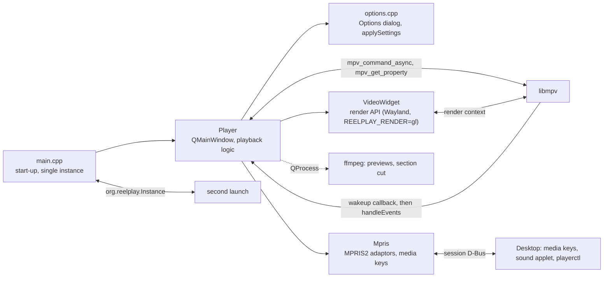

# Architecture

Reelplay is one `QMainWindow` (`Player`) plus a few helpers. The window owns an mpv handle, creates every menu and widget, and turns mpv's events into UI changes. There is no separate controller or model layer: the playlist is a `QListWidget`, and most state is read from mpv when needed.

## Components

| Component | Files | Role |
|---|---|---|
| Start-up | `main.cpp` | Creates the `QApplication`, sets the C numeric locale, migrates old settings, handles the single-window handshake, creates the window. |
| Player | `player.h`, `player.cpp` | The window and all playback logic: menus, playlist, transport, track handling, previews, recording, settings it owns. |
| Options | `options.cpp` | The Options dialog, `applySettings()` (re-applies every saved setting to mpv), and the dark theme. |
| Video output | `videowidget.h`, `videowidget.cpp` | A `QOpenGLWidget` that draws mpv's frames through the libmpv render API. Used on Wayland and when `REELPLAY_RENDER=gl` is set. |
| MPRIS | `mpris.h`, `mpris.cpp` | Publishes the player on the session bus (`org.mpris.MediaPlayer2`), grabs media keys, and emits property-change signals. |

On X11 the video is not drawn by `VideoWidget`. The window is a plain `QWidget` with a native window, and mpv draws into it through the `wid` option. See [mpv integration](mpv-Integration.md#video-output).

## Threads

Everything Reelplay does happens on the GUI thread. mpv runs its own threads, and two callbacks come from them:

- The **wakeup callback** (set with `mpv_set_wakeup_callback`) fires on an mpv thread. It only posts a queued call to the GUI thread, which runs `handleEvents()`.
- The **render update callback** in `VideoWidget` does the same for repainting.

Calls from the GUI thread to mpv are either:

- **Asynchronous** through `command()` (`mpv_command_async`). The call returns at once and the result is not checked. A property read straight after a command may still show the old value.
- **Synchronous** through `prop()` (`mpv_get_property_string`) and `step()` (`mpv_get_property` and `mpv_set_property`). `step()` is synchronous so that fast key repeat never loses a step.

ffmpeg runs as a child process through `QProcess`, with `finished` handlers. Two things use it: section cutting (`saveAbSection`) and seek previews (`startPreviewJob`).

### Timers

| Timer | Interval | Purpose |
|---|---|---|
| `clickTimer` | Double-click interval (the platform's) | A single click on the video pauses only after this delay, so a double-click does not also pause. |
| `idleTimer` | 2 s | In fullscreen, hides the cursor and the controls after the mouse rests. |
| `statsTimer` | 500 ms | Refreshes the Ctrl+J statistics overlay. |
| `previewDebounce` | 150 ms | Waits for the mouse to settle over the seek bar before starting an ffmpeg preview. |
| `seriesTimer` | User's choice, 1 to 3600 s | Takes a screenshot every N seconds (File > Screenshot Series). |

## Start-up sequence

1. `main()` creates the `QApplication`, sets the names used for settings and the desktop file, sets `LC_NUMERIC` to `C`, and calls `migrateOldName()`.
2. Each argument that is an existing file becomes an absolute path. URLs are left alone.
3. If the `singleInstance` setting is on and the session bus is connected, `main()` tries to register `org.reelplay.Instance`.
   - If another instance already has the name, `main()` calls its `openFromOtherInstance(files)` over D-Bus, with a 5 s timeout. If it answers, this process exits with 0.
   - If nobody answers, this process carries on as its own window.
4. `new Player` runs the constructor:
   1. `mpv_create()`, then choose the video path (render API on Wayland, embedding on X11).
   2. Build the widgets, the playlist dock and every menu. Menu actions are created with `act()`, which gives them stable object names for hotkey remapping.
   3. Set the mpv start-up options, then `mpv_initialize()`.
   4. `applySettings()` pushes every saved setting into mpv.
   5. Create `Mpris`, the media-key actions, and the property observers. Install the wakeup callback.
   6. Restore the saved volume, window geometry and window state.
5. If this process owns the bus name, it exports the window at `/org/reelplay`. Then it shows the window, opens any files from the command line, and runs `app.exec()`.

## Shutdown sequence

`closeEvent()` runs in this order, and the order matters:

1. Leave fullscreen first, so the saved geometry is the windowed one.
2. Save the volume, the window geometry and the window state.
3. `shutdown()`:
   1. If something is loaded, call `write-watch-later-config` **synchronously**, so the resume position is written before mpv goes away.
   2. `VideoWidget::release()` frees the render context, if there is one, before `mpv_terminate_destroy()`.
   3. `mpv_terminate_destroy()`, and `mpv` is set to `nullptr`.
4. Qt destroys the window and its children, including `Mpris`.

Calling `shutdown()` from the destructor is safe: it does nothing once `mpv` is `nullptr`. Freeing the render context after Qt has destroyed the GL context, or letting mpv draw into a native window Qt has already destroyed, aborts the process. See [Design decisions](Design-Decisions.md#ordered-teardown).

## Event loop

`handleEvents()` drains mpv's queue: `mpv_wait_event(mpv, 0)` until it returns `MPV_EVENT_NONE`. It handles:

- property changes for the observed properties (see [mpv integration](mpv-Integration.md#observed-properties));
- `MPV_EVENT_START_FILE`, `MPV_EVENT_FILE_LOADED`, `MPV_EVENT_END_FILE`;
- `MPV_EVENT_PLAYBACK_RESTART`, which tells MPRIS about a seek;
- `MPV_EVENT_SHUTDOWN`, which closes the window.

At the end of each call it runs `mpris->update()`, which compares the MPRIS properties with the last values sent and emits `PropertiesChanged` for any that changed.

## State

Most state lives in mpv. Reelplay keeps a little of its own, as plain members of `Player`:

| Member | Meaning |
|---|---|
| `stopped` | True when nothing is loaded or after Stop. Separate from mpv's `idle` state. |
| `current` | Index of the playing playlist row, or -1. Kept in step with the list by `syncCurrent()`. |
| `chapters`, `duration` | Cached from mpv for the seek bar and chapter menu. |
| `repeat` | Repeat mode: off, file or playlist. |
| `folderNeighbors[2]` | The previous and next file in the folder, when a single file is open. |
| `pendingSeek` | A favourite's time, applied once the file has loaded. |
| `srcSize` | The file's size before cropping, used to compute crops. |
| `previewCache`, `previewProc`, and related | Seek-bar preview state. |

`Player` declares `friend class PlayerTest`, `Mpris`, `MprisRoot` and `MprisPlayer`, so the tests and the MPRIS adaptors can reach these members directly.
